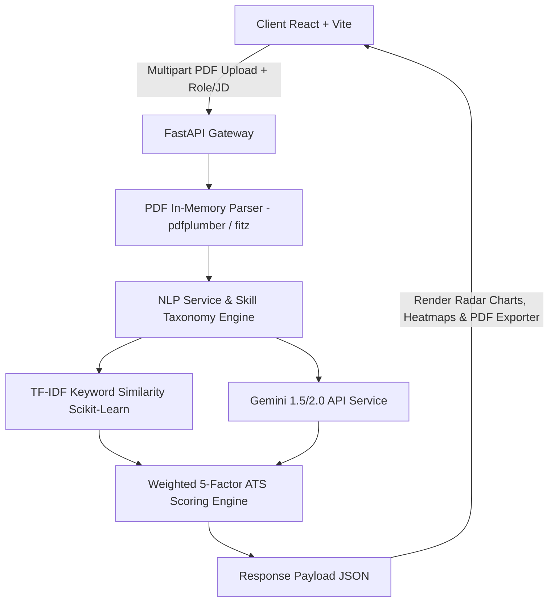

# 🚀 AI Resume Analyzer & Job Matcher (MatchCraft AI)

An enterprise-ready, production-grade **AI Resume Analyzer & Job Matcher** application built with Python **FastAPI**, **React.js (Vite + Tailwind CSS)**, and **Google Gemini API**.

Evaluate candidate PDF resumes against specific Job Descriptions or pre-configured technical roles with a **weighted 5-factor ATS scoring formula**, **ATS keyword heatmaps**, **Resume Health 5-star checklists**, **Resume section auditing**, and **Recharts visualizations**.

---

## 🌟 Key Features

- **Weighted Multi-Factor ATS Score**: Calculates realistic match percentage:
  $$\text{Final Score} = 0.4 \times \text{Skill} + 0.2 \times \text{Experience} + 0.1 \times \text{Education} + 0.2 \times \text{Keywords} + 0.1 \times \text{Formatting}$$
- **Zero Database & 100% In-Memory Privacy**: Resume files are parsed as byte streams in-memory using `pdfplumber` with fallback to `PyMuPDF (fitz)`. No files are saved on disk or database.
- **Role-Based Job Description Generator**: Select from 17+ pre-configured industry roles (AI Engineer, React Dev, SDE, DevOps) to automatically generate professional JDs via Gemini API.
- **ATS Keyword Heatmap**: Color-coded matched (Green ✓), partial (Yellow ⚡), and missing (Red ✗) skills categorized by domain (Frontend, Backend, Cloud, DevOps, AI/ML).
- **Resume Health Score & Checklist**: Star rating (1.0 to 5.0) auditing action verbs, quantified metrics (%, $, numbers), contact details, LinkedIn, Portfolio, and GitHub links.
- **Resume Section Audit**: Identifies present vs missing standard sections (Summary, Experience, Education, Projects, Certifications, Achievements).
- **Interactive Recharts Visualizations**: 5-axis Radar Chart, Matched vs Missing Skill Pie Chart, and TF-IDF Keyword Density distribution.
- **Gemini AI Career Reasoning**: Generates candidate summary, key strengths, weaknesses, project suggestions, high-value certifications, interview prep tips, 30-60-90 day learning roadmap, and career advice.
- **One-Click PDF Report Export**: Export complete evaluation reports directly to printable PDF format.
- **Stepped Animated UI Loader**: Real-time progress tracker through extraction, parsing, matching, and AI synthesis steps.

---

## 📐 System Architecture



---

## 🛠️ Tech Stack

### Frontend
- **Framework**: React.js 18 + Vite
- **Styling**: Tailwind CSS (Dark/Light mode, Glassmorphic UI, Blue-Purple gradients)
- **Charts**: Recharts (RadarChart, PieChart)
- **File Upload**: React Dropzone
- **Animations**: Framer Motion & Lucide Icons
- **PDF Export**: html2canvas + jsPDF

### Backend
- **Framework**: Python 3.11 + FastAPI + Uvicorn
- **PDF Extraction**: `pdfplumber` + `PyMuPDF (fitz)` fallback
- **NLP & Scikit-Learn**: TF-IDF Cosine Similarity & RegEx Section Parser
- **AI Intelligence**: `google-generativeai` (Gemini API) with strict JSON response enforcement
- **Validation**: Pydantic v2 schemas

---

## 📂 Project Structure

```
AI-Resume-Analyzer-and-Job-Matcher/
├── client/                     # React + Vite Frontend Application
│   ├── src/
│   │   ├── components/
│   │   │   ├── analyzer/       # UploadZone, RoleSelector, ProgressStepper, AnalysisForm
│   │   │   ├── landing/        # Hero, Features, HowItWorks, TechStack, FAQ
│   │   │   ├── layout/         # Navbar, Footer
│   │   │   ├── results/        # ScoreOverview, RadarChart, ResumeHealth, Heatmap, FeedbackTabs
│   │   │   └── ui/             # Button, Badge, Card
│   │   ├── constants/          # Pre-configured roles
│   │   ├── context/            # ThemeContext (Dark/Light)
│   │   ├── hooks/              # useAnalyzer custom hook
│   │   ├── pages/              # Home, AnalyzerPage
│   │   ├── services/           # Axios API client
│   │   └── utils/              # PDF Exporter utility
│   ├── package.json
│   ├── tailwind.config.js
│   └── vite.config.js
├── server/                     # FastAPI Backend Application
│   ├── app/
│   │   ├── api/                # Endpoints (/health, /roles, /extract-resume, /generate-jd, /analyze)
│   │   ├── config/             # Environment & settings
│   │   ├── prompts/            # Gemini system prompts
│   │   ├── schemas/            # Pydantic schemas
│   │   ├── services/           # PDF, NLP, Gemini, Analyzer services
│   │   └── utils/              # Helper functions
│   ├── tests/                  # Backend unit tests
│   ├── main.py                 # FastAPI application entrypoint
│   └── requirements.txt
├── .env.example
├── .gitignore
└── README.md
```

---

## 🔌 API Documentation

### 1. `GET /api/v1/health`
Returns system status and Gemini API configuration state.

### 2. `GET /api/v1/roles`
Returns list of supported pre-configured technical roles.

### 3. `POST /api/v1/generate-jd`
Generates a professional Job Description for a selected role name.
- **Request**: `{"role": "AI Engineer"}`
- **Response**: `{"role": "AI Engineer", "job_description": "..."}`

### 4. `POST /api/v1/analyze`
Main ATS evaluation endpoint. Accepts multipart form data.
- **Form Data**:
  - `file`: PDF Resume file (Required, max 10MB)
  - `role`: Target role name (Optional)
  - `job_description`: Custom Job Description text (Optional)

---

## 🚀 Local Installation & Setup Guide

### Prerequisites
- Node.js v18+ and npm
- Python 3.10+ and pip

### 1. Clone Repository
```bash
git clone https://github.com/Shirkesneha22/AI-Resume-Analyzer-and-Job-Matcher.git
cd AI-Resume-Analyzer-and-Job-Matcher
```

### 2. Configure Environment Variables
Copy `.env.example` to `server/.env`:
```bash
cp .env.example server/.env
```
Edit `server/.env` and add your Google Gemini API key:
```env
GEMINI_API_KEY=your_actual_gemini_api_key_here
```

### 3. Setup & Start Backend Server
```bash
cd server
python -m venv venv
# On Windows:
venv\Scripts\activate
# On macOS/Linux:
# source venv/bin/activate

pip install -r requirements.txt
python main.py
```
Backend will start on `http://localhost:8000`. Swagger API docs available at `http://localhost:8000/docs`.

### 4. Setup & Start Frontend Client
In a new terminal window:
```bash
cd client
npm install
npm run dev
```
Frontend application will launch at `http://localhost:5173`.

---

## 🌐 Production Deployment

- **Backend Deployment (Render / Railway / Fly.io)**:
  - Build Command: `pip install -r server/requirements.txt`
  - Start Command: `uvicorn server.main:app --host 0.0.0.0 --port $PORT`
  - Environment Variable: Set `GEMINI_API_KEY` in environment dashboard.

- **Frontend Deployment (Vercel / Netlify)**:
  - Root Directory: `client`
  - Build Command: `npm run build`
  - Output Directory: `dist`
  - Environment Variable: Set `VITE_API_URL` to deployed backend URL.

---

## 📄 License

MIT License © 2026 Shirke Sneha. Built for AI Engineer Portfolio & Technical Showcase.
